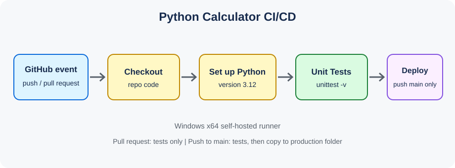
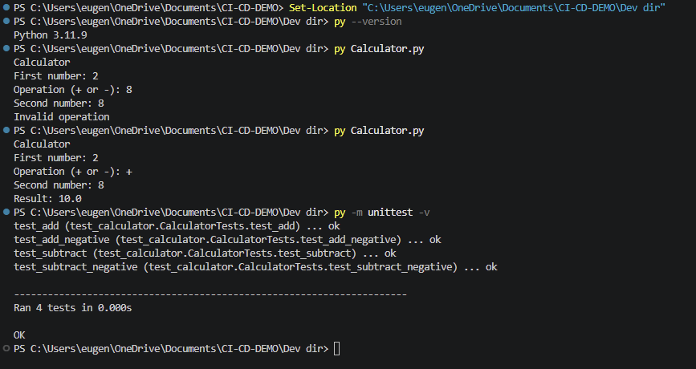
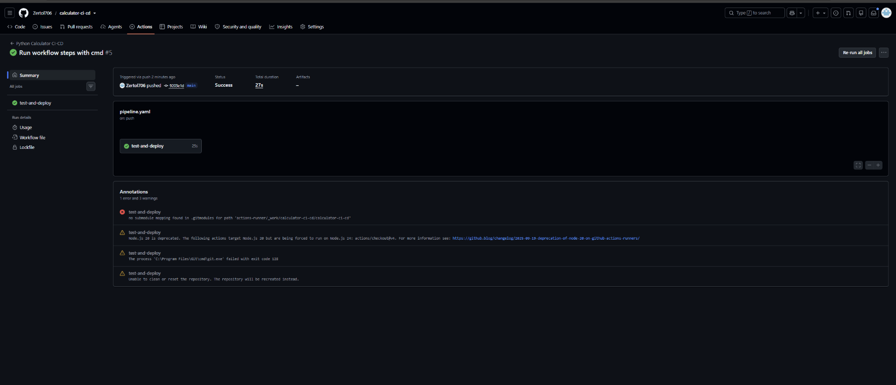
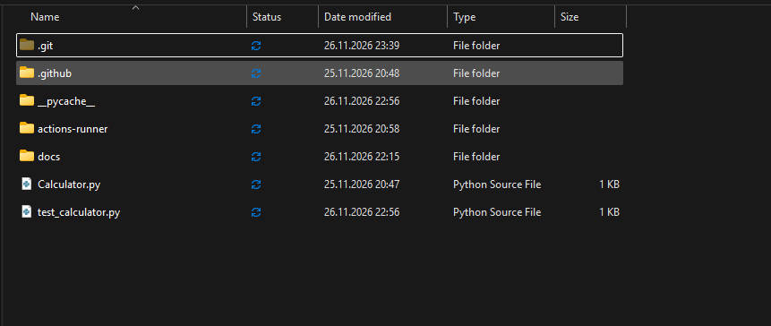

# Как работает CI/CD в проекте

Это учебный проект: калькулятор на Python, автоматические тесты и CI/CD с помощью GitHub Actions.

Настройки находятся в [`.github/workflows/pipeline.yaml`](.github/workflows/pipeline.yaml). При `push` в ветку `main` или создании pull request в `main` GitHub запускает workflow на Windows self-hosted runner.

## Шаги workflow

1. Получает код из репозитория.
2. Проверяет версию установленного Python командой `py --version` (на runner установлен Python 3.11.9).
3. Запускает четыре автоматических теста командой `py -m unittest -v`.
4. При успешном `push` в `main` копирует `Calculator.py` в `C:\CI-CD-Demo\Prod dir`. При pull request деплой не выполняется.

CI автоматически проверяет код тестами, чтобы ошибки обнаруживались до деплоя. CD доставляет проверенный файл в папку деплоя.

## Проверка проекта на компьютере

Открой терминал в папке проекта и выполни:

```powershell
py --version
py Calculator.py
py -m unittest -v
```

Для успешного запуска тестов в конце должно появиться `OK`.

## Скриншоты

Схема этапов CI/CD:



Локальный запуск калькулятора и тестов:



Успешный запуск GitHub Actions после push в `main`:



Структура папки проекта:



На скриншоте GitHub Actions статус job — `Success`. Заметка в разделе Annotations относится к очистке рабочей папки runner после выполнения job.
