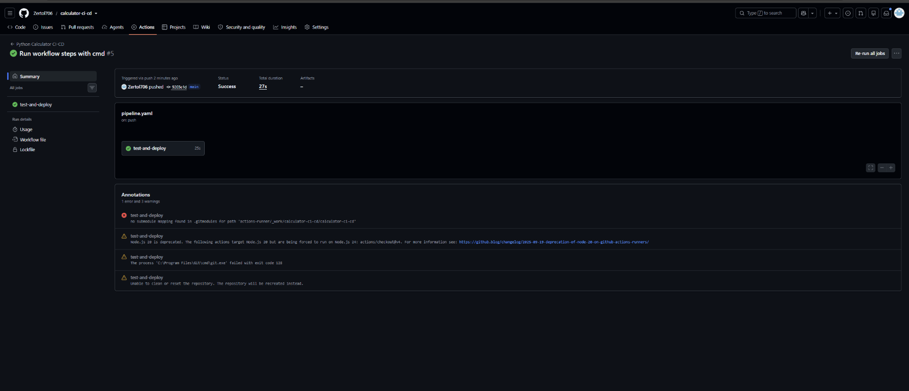
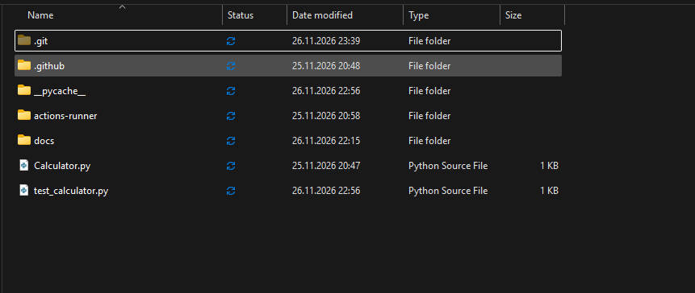

Как работает CI/CD в проекте
Настройки находятся в pipeline.yaml. При push в main или создании pull request в main GitHub запускает задания на  Windows runner’е:

1 Скачивает код проекта
2 Использует установленный на runner Python через команду `py` (сейчас Python 3.11.9)
3 Проверяет версию Python
4 Запускает автоматические тесты командой `py -m unittest -v`

Если это push в main и предыдущие шаги прошли успешно копирует Calculator.py в "C:\CI-CD-Demo\Prod dir" При pull request деплой пропускается
CI автоматически проверяет изменения тестами чтобы ошибки находились до использования программы. CD автоматически доставляет проверенный файл в папку деплоя. Для этого калькулятора деплой просто копирует файл 
каждый отправленный push создаёт отдельный запуск workflow.

[Схема этапов CI/CD](screenshots/pipeline-flow.svg)

Set-Location "C: Влад\Secret_document\Любимый_ученик_Igors_Burlakovs\Проект_на_8_баллов"

py --version

py Calculator.py

py -m unittest -v

[Терминал: калькулятор и четыре пройденных теста](screenshots/terminal-tests.png)

## Успешный запуск GitHub Actions

На скриншоте показан workflow с успешным статусом после push в ветку `main`.

## Структура папки проекта

На скриншоте показаны файлы и папки проекта на компьютере.

